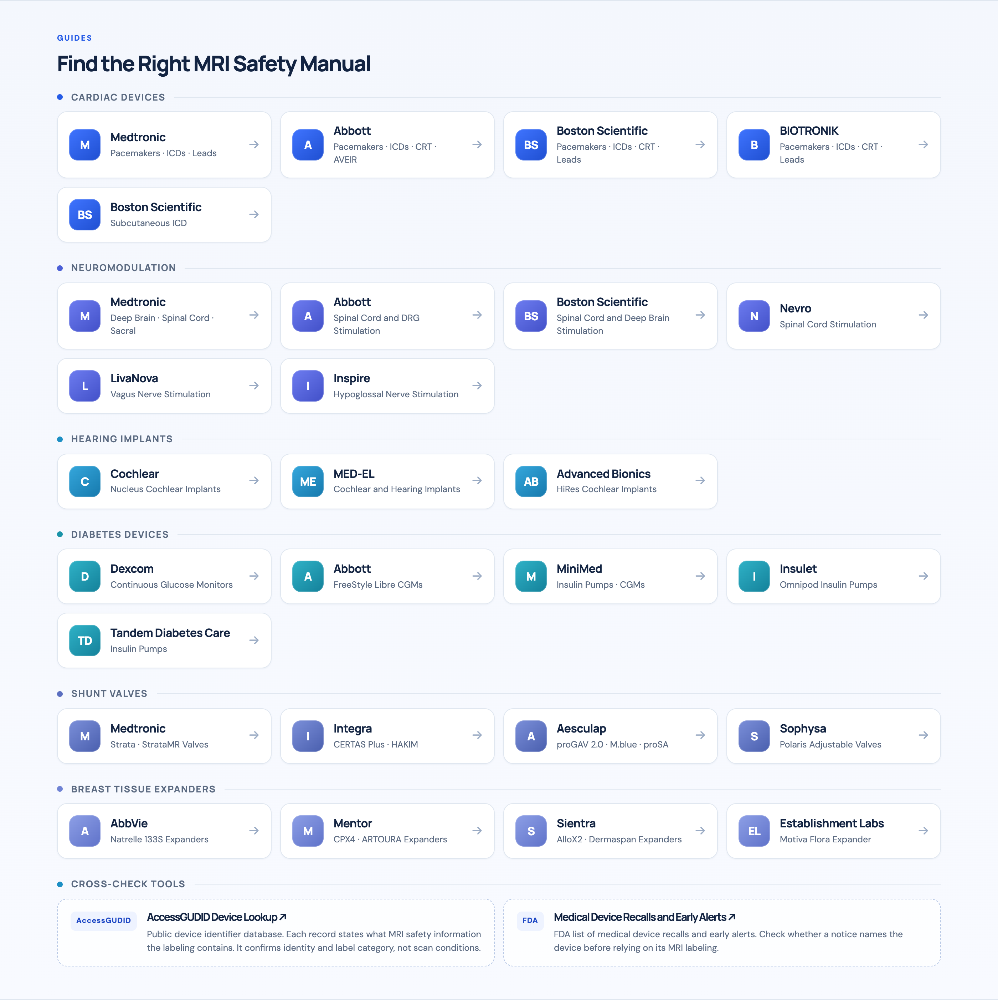

<div align="center">


# MR Safety Agent

**MRI Safety Research for Implants, Devices, and MR Safety Questions, with Each Claim Tied to a Source It Opened.**

<a href="https://mri-commons.github.io/mr-safety-agent/"></a>

[](skills/mr-safety-agent/SKILL.md)
[](LICENSE)
[](https://agentskills.io)
[](#scope-and-limits)

[Install](#install) · [With and Without the Skill](#same-ai-with-and-without-the-skill) · [Website](https://mri-commons.github.io/mr-safety-agent/) · [Feedback](#feedback) · [Contributing](CONTRIBUTING.md)

</div>

> [!IMPORTANT]
> MR Safety Agent is research support, not scan clearance, and it has not been clinically validated. It does not interpret images or prescribe scanner settings. Each MR safety decision stays with the facility's MRMD and MR safety team. Never enter patient identifiers. Device details are all it needs.

MR Safety Agent is an open-source [Agent Skill](https://agentskills.io): a set of instructions and source routes that teaches an AI assistant to research MR safety the way a careful MR safety officer would. One package is designed for Claude, ChatGPT, and Gemini products that support skills.

## What It Does

| Task | What You Get |
| :---: | --- |
| 📄<br>**Device MRI Labeling** | The applicable manufacturer manual, matched to the exact model, market, and revision, with safety notices checked, conditions cited by page, and gaps listed. |
| 🧲<br>**MR Safety Questions** | Answers grounded in ACR, FDA, and other primary sources, including MRI suite emergencies, in plain language for patients and families or in depth for the MR safety team. |
| 🎓<br>**US Certification** | MRSO, MRSE, MRMD, and MRST pathways from the credentialing body, with course certificates, credentials, and job roles kept distinct, and study plans built from the current exam syllabus. |

## Same AI, With and Without the Skill

Two examples, each the same question asked of the same model with and without the skill:

| Question | ❌ Without the Skill | ✅ With MR Safety Agent |
| --- | --- | --- |
| *"ACCOLADE MRI L311 pacemaker with INGEVITY MRI 7741/7742 leads: what are the current US 3T conditions?"* | Found the current US guide and its 3T conditions, but missed the May 2026 FDA Class I correction listing the L311, a Safety Mode risk | Same guide, each condition cited by page; found the FDA correction and flagged Safety Mode status to confirm |
| *"Abbott Proclaim XR SCS with two 3228 leads: what does the current US manual say for a 3T lumbar MRI?"* | Right conclusion (1.5T only), but read an older third-party copy and offered its outdated limits as the stricter option | Used the current official manual (December 2025) and documented which edition it replaced |

## Who It's For

| If You Are… | Use It To… |
| :---: | --- |
| 👪<br>**A Patient or Family Member** | Learn what device information the imaging team needs and what to ask, in plain language. |
| 🩻<br>**An MR Technologist or MR Safety Officer** | Find the right manual and revision, get page-cited conditions, and see what still needs checking before the scan. |
| 🩺<br>**A Radiologist or Referring Physician** | Review the evidence behind a device's MR labeling and the open questions. |
| 📚<br>**A Student or Learner** | Understand MR safety concepts and plan US certification from the exam syllabus. |

### Built to Catch What Is Easy to Miss

- **Wrong Edition.** It reads each document's own identity line, so a European manual or a superseded revision is not passed off as current US labeling.
- **Safety Notices.** It looks for FDA and manufacturer notices that affect the device and opens them before judging whether they apply.
- **Tables and Footnotes.** It reads the conditions pages in full and checks table values on the rendered page.
- **Over-Generalizing.** One system's conditions are never applied to another system, lead, or field strength.
- **Honest Gaps.** It lists only the sources it actually opened and labels what it could not verify.

## Install

> [!NOTE]
> Menus change. If a step differs, follow your tool's current documentation.

**Chat Apps (Claude, ChatGPT, Gemini)**

1. **Download** [`mr-safety-agent.zip`](https://mri-commons.github.io/mr-safety-agent/assets/mr-safety-agent.zip) from the [website](https://mri-commons.github.io/mr-safety-agent/).
2. **Upload** it to your app:

   | App | Where to Upload (October 2026) |
   | --- | --- |
   | **Claude** (web, desktop, mobile) | Turn on **Settings → Capabilities → Code execution and file creation**, then upload in **Customize → Skills**. |
   | **ChatGPT** | Paid plans, including Plus, Pro, Business, Enterprise, Healthcare, and Edu: **Plugins → Skills → Create → Upload from your computer**. Uploaded skills work only in **Work**, not in regular chat. Enterprise and Edu admins may need to enable skills. |
   | **Gemini** | Skills began rolling out in October 2026. When **Skills** appears, upload the zip. |

3. **Make Sure the Skill Is Turned On**, then ask normally or name it. In ChatGPT, use it in **Work**.

**Coding Agents** such as Claude Code, Codex, and Gemini CLI. One command with the [skills CLI](https://github.com/vercel-labs/skills) (requires Node.js; add `-g` to install for all projects):

```sh
npx skills add mri-commons/mr-safety-agent --skill mr-safety-agent
```

## Try Asking

| | Ask | What You Get |
| :---: | --- | --- |
| 🦻<br>**Device** | *"Cochlear Nucleus CI612 with the magnet in place, 3T brain MRI: which current US document applies, and what does it require?"* | The matched US Cochlear guidelines, the 3T conditions with the magnet in place cited by page, and what remains unknown. |
| 👪<br>**Patient** | *"My father has a Medtronic pacemaker from around 2018. Can he have a 3T MRI tomorrow?"* | A short, plain-language answer: why the exact model matters, where to find it (usually the implant card), and whom to call. No yes-or-no guess. |
| 📘<br>**Guidance** | *"Per the current ACR Manual on MR Safety, who controls access to Zone III?"* | The answer from the current ACR manual, with its citation. |

## Website

A static companion site lets anyone use the project without installing an AI tool:

- **Guides**: twenty-seven guides in six groups: cardiac devices, neuromodulation, hearing implants, diabetes devices, shunt valves, and breast tissue expanders. They cover Medtronic, Abbott, Boston Scientific, BIOTRONIK, Nevro, LivaNova, Inspire, Cochlear, MED-EL, Advanced Bionics, Dexcom, MiniMed, Insulet, Tandem, Integra, Aesculap, Sophysa, AbbVie, Mentor, Sientra, and Establishment Labs. Each guide explains where the manufacturer publishes MRI documents, how to find the current US edition, how to confirm it, and the traps to avoid.
- **Key References**: ACR, FDA, RadiologyInfo, and IBMRS pages, plus cross-check tools such as AccessGUDID and FDA's recall list.
- **Skill Download and Install Options.**



## How It Works

The AI reads only the workflow it needs. A [source directory](skills/mr-safety-agent/references/sources.json) gives curated starting points and verified notes on how each manufacturer's library finds the current revision. Every current claim must come from a source opened during the task, and the answer lists only the sources actually opened. The package has no model, hosted service, or clinical integration. Search and PDF reading come from your AI tool.

## Scope and Limits

- **US-First.** Other regions are not yet covered. Regional contributions are welcome.
- **Not a Database.** The directory lists starting points, not stored device labels. Manuals are linked, not redistributed.
- **Tool-Dependent.** As of October 2026, behavior has been evaluated in Claude Code, with limited testing in ChatGPT Work. Other hosts are untested.
- **Privacy.** Never enter patient identifiers. Device details are all it needs.

## Feedback

Every comment, correction, and suggestion is welcome. [Open an issue](https://github.com/mri-commons/mr-safety-agent/issues/new) to report a wrong or outdated source, a misleading answer, or an idea. Leave out patient information.

## Contributing

Corrections, new sources, and regional proposals are welcome. [CONTRIBUTING.md](CONTRIBUTING.md) covers source rules, quality checks, and development setup.

## License

Original project materials are under the [MIT License](LICENSE). Third-party publications, device manuals, trademarks, and linked content keep their own terms. No affiliation with or endorsement by any listed organization is claimed.

MR Safety Agent is part of [MRI Commons](https://github.com/mri-commons), a home for open MRI projects.

## Star History

<a href="https://github.com/mri-commons/mr-safety-agent/stargazers">
  <picture>
    <source media="(prefers-color-scheme: dark)" srcset="https://mri-commons.github.io/mr-safety-agent/assets/star-history-dark.svg">
    
  </picture>
</a>
